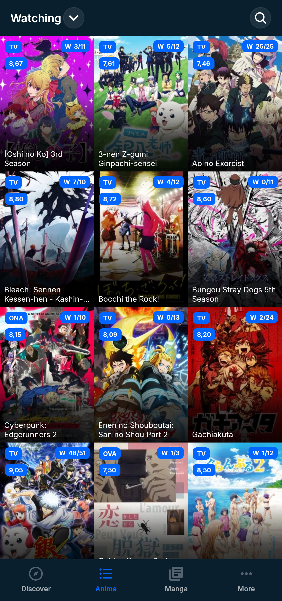
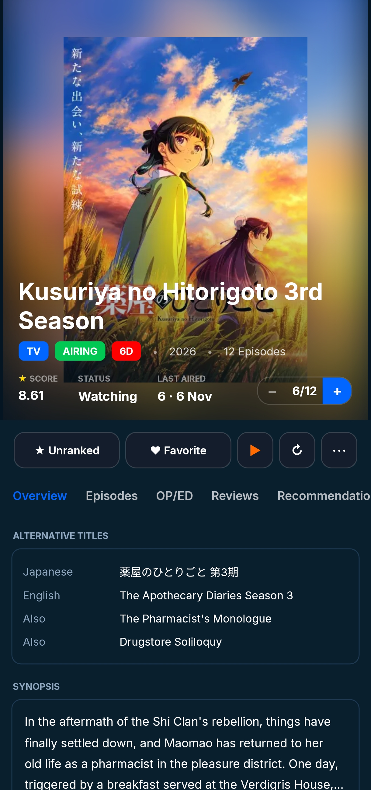

<p align="center">
  
</p>

<h1 align="center">MAL+ (MALPlus)</h1>

<p align="center">
  <strong>A modern, ultra-responsive, privacy-first MyAnimeList client for Android.</strong><br>
  Built from the ground up with <strong>.NET 11</strong> and <strong>.NET MAUI</strong>.
</p>

<p align="center">
  
  
  
  
  
</p>

---

## ✨ Features

- 🎨 **Fluid Dark-First Interface:** Built specifically for Android with native `ViewPager2` tab navigation, smooth swipe gestures between libraries, and an interactive bottom bar that stays anchored across root sections.
- ⚡ **Offline Seed Bundle:** Ships with an offline database containing **over 500 popular and currently airing anime titles** pre-populated with details, synopsis, and episode lists. Browse instantly on cold start without waiting for network requests.
- 🎵 **Integrated AnimeThemes Player:** Native video and audio playback for Opening (OP) and Ending (ED) themes powered by **AndroidX Media3 (ExoPlayer)** directly within anime details.
- 📚 **Full Library Management:** Seamless two-way sync with MyAnimeList. Update scores, watched episodes, reading volumes, status tags, rewatching progress, and private notes.
- 🔍 **Rich Discovery & Seasonal Archives:** Explore seasonal rankings, trending titles, top anime, top manga, and the unique *"Adapted to Anime"* manga section.
- 📅 **Broadcast Calendar & Airing Countdowns:** Keep track of upcoming episodes with accurate broadcast countdowns calculated dynamically from release timestamps.
- 💬 **Native Forums Browser:** Read and participate in MyAnimeList community discussions natively—featuring quote trees, reply composers, and page navigation.
- 🔄 **Integrated In-App Updater:** Daily background update checks and one-tap manual checks that notify you when a new release is available with full changelog view.
- 🛡️ **100% Local & Private:** Zero third-party telemetry, zero tracking, and no external analytics. Local diagnostics and crash logs can be exported directly from Settings to a `.txt` support bundle via the Android share sheet.

---

## 📱 Preview & Screenshots

<p align="center">
  
  &nbsp;&nbsp;&nbsp;&nbsp;
  
</p>

---

## 📥 Download & Installation

You can download the latest installable APK directly from the **[Releases](https://github.com/idarkalex/MALPlus/releases)** section.

1. Download `com.idarkalex.malplus.apk` from the latest release.
2. Open the downloaded file on your Android device (ensure *"Install unknown apps"* permission is granted).
3. Sign in with your MyAnimeList account (or explore publicly without an account).

---

## 🏗️ Architecture & Tech Stack

| Layer | Technology |
|---|---|
| **Framework** | .NET 11.0 (allow-prerelease) + .NET MAUI Workload |
| **Platform Target** | Android 7.0 (API 24) to Android 15 (API 35+) |
| **Architecture** | MVVM (Model-View-ViewModel) with decoupled service locators |
| **Media Playback** | AndroidX Media3 / ExoPlayer via custom native MAUI handler |
| **Graphics & Drawing** | SkiaSharp for Android |
| **Metadata Providers** | **Tenrai API** (high-speed catalogue & episodes fallback), **MyAnimeList API** (user library & auth), and **AnimeThemes GraphQL** (openings & endings) |
| **Storage & Cache** | Private app storage JSON caches with bounded TTL and stale-while-revalidate degradation |

---

## 🛠️ Building from Source

### Prerequisites
- Windows 10/11 or Linux with Android SDK installed
- [.NET 11 SDK](https://dotnet.microsoft.com/) (pinned in `global.json`)
- .NET MAUI Android workload (`dotnet workload install maui-android`)
- JDK 21 (Microsoft OpenJDK recommended)
- Android SDK build tools 36.0.0+ and platform 33+

### Incremental Build & Deploy (Dev Loop)

For active local iteration over adb (WiFi or USB):

```powershell
# Deploy to connected physical device
.\build_and_deploy.ps1 -Device "192.168.1.XXX:PORT"
```

> **Note:** Compilations must always be incremental. Avoid running `dotnet build -t:Rebuild`, as it discards build caches.

### Release Build

```bash
dotnet build MALPlus/MALPlus.csproj -f net11.0-android37.0 -p:Configuration=Release
```

---

## 🤝 Community & Support

- **Found a bug?** Open a **[Bug Report](https://github.com/idarkalex/MALPlus/issues/new?template=bug_report.yml)**. Please include your device model, Android OS version, and export your local diagnostic log from *Settings > DIAGNOSTICS & LOGS*.
- **Have an idea?** Submit a **[Feature Request](https://github.com/idarkalex/MALPlus/issues/new?template=feature_request.yml)** to suggest new features or visual enhancements.
- **Want to contribute?** Read our **[Contributing Guidelines](CONTRIBUTING.md)** before opening a Pull Request.

---

## 💖 Acknowledgments & Credits

MAL+ is built with immense gratitude towards the open-source community:

- **[Drutol](https://github.com/Drutol)**: Author and creator of the original [MALClient](https://github.com/Drutol/MALClient) (UWP / Xamarin), which laid the foundation for this client.
- **[idarkalex](https://github.com/idarkalex)**: Project maintainer, responsible for the fork, modern .NET 11 MAUI rewrite, and performance enhancements.
- **[Tenrai API](https://api.tenrai.org)**: For providing fast, reliable anime and manga metadata and episode catalogue APIs.
- **[AnimeThemes](https://animethemes.moe)**: For maintaining an open repository of high-definition anime themes (OP/ED).
- **[MyAnimeList](https://myanimelist.net)** & **[AniList](https://anilist.co)**: For providing the core anime communities and databases that make this app possible.

---

## 📄 License

MAL+ is open-source software licensed under the **[GNU General Public License v3 (GPLv3)](LICENSE.md)**.
