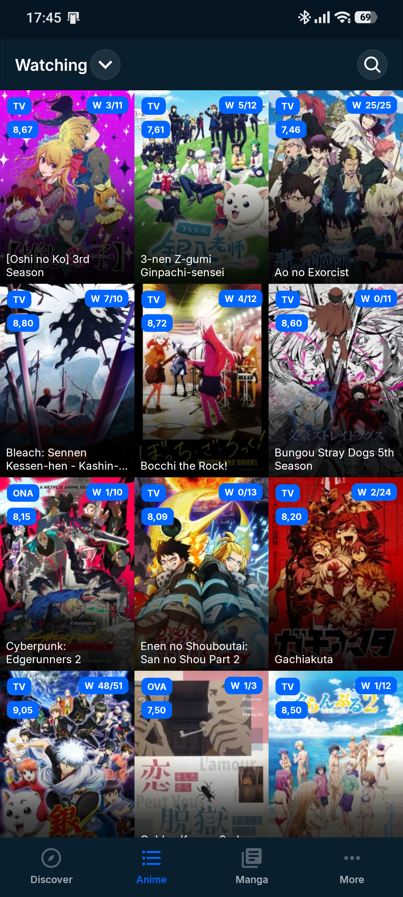

<h1 align="center">MAL+</h1>

<p align="center">
  
  <br><br>
  A MyAnimeList client for Android, built with .NET MAUI.
</p>

> MAL+ is an independent .NET MAUI port of [MALClient by Drutol](https://github.com/Drutol/MALClient),
> originally forked by [idarkalex](https://github.com/idarkalex/MALClient).
> Released under the [GNU GPL v3](LICENSE.md) — the original project and this port keep that licence.

> **Where the data comes from:** most metadata (details, episodes, characters, staff, seasonal, studios,
> genres, search, favourites) is served by the **Tenrai API** (`https://api.tenrai.org/v1`). Top anime,
> top manga and "Adapted to anime" are scraped from MyAnimeList. The official MAL API handles the
> anime/manga list, scores and library updates. See [docs/TENRAI_API.md](docs/TENRAI_API.md).

### Download

Get the latest signed APK from [Releases](https://github.com/idarkalex/MalPlus/releases).

### Screenshots

<p align="center">
  
</p>

### Features

* Anime and manga list updates — score, status, episodes, volumes, tags, favourites, rewatching, start/end dates.
* Library views with sorting and filters: poster grid, compact and detailed layouts.
* Details with tabs for general info, details, reviews, recommendations, related entries, characters and staff.
  * OP/ED theme search, promotional trailers and in-app video playback.
  * Airing countdowns pulled from real episode timestamps.
* Top anime and top manga using the real MyAnimeList categories
  (top manga: All, Manga, Novels, Light Novels, One Shots, Doujinshi, Manhwa, Manhua, Popular, Favourited).
* "Adapted to anime" manga section — All / Airing Now / Upcoming Anime.
* Seasonal anime with multiple-season selection, current season marked, sorted by MAL score.
* Calendar with countdowns to the next episode.
* Discover home page with seasonal, top, adapted, news and personal sections.
* Random anime and manga pickers with filters.
* MAL articles and news (including ANN), messaging, notifications, history, friends feeds and clubs.
* Forums as native pages — reading, replying and creating topics — not a wrapped website.
* Profile with navigation across other users' profiles, profile comments and comment conversations.
* An in-app link protocol: `malplus://<any MyAnimeList link>` (accepted URLs in
  [MalLinkParser.cs](MALPlus.Core/XShared/Utils/MalLinkParser.cs)).
* Dark-first UI built for Android, with launcher shortcuts and pull-to-refresh throughout.

### Building

Android only, and the SDK is pinned by [`global.json`](global.json) so the exact preview SDK is used
regardless of what else is installed on the machine. The .NET MAUI Android workload is the only
prerequisite.

```bash
dotnet build MALPlus/MALPlus.csproj -f net11.0-android37.0 -p:Configuration=Release
```

[`build_and_deploy.ps1`](build_and_deploy.ps1) is the local dev loop: incremental build, install and
launch over `adb` in one step. Never run `dotnet build -t:Rebuild` through it — Rebuild throws away
incremental state and regenerates thousands of files.

GitHub Actions builds the signed APK on every push to `main`; every `v*` tag also publishes a GitHub
Release with the APK attached.

### Project layout

| Path | What it is |
|---|---|
| `MALPlus` | The MAUI app: pages, controls, converters, platform code, Android manifest |
| `MALPlus.Core` | Platform-independent logic: view models, queries, models, cache, utilities |
| `docs` | API notes and the Xamarin→MAUI migration audit |
| `Branding` | Icon and splash artwork sources |

### Licence

GNU General Public License v3. See [LICENSE.md](LICENSE.md).