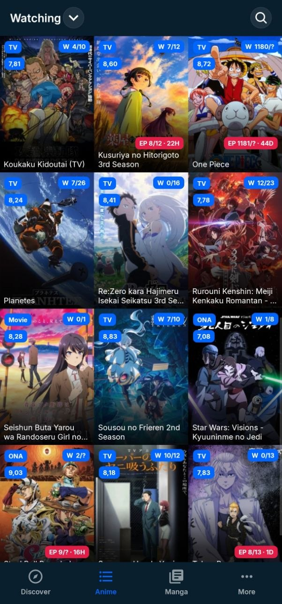
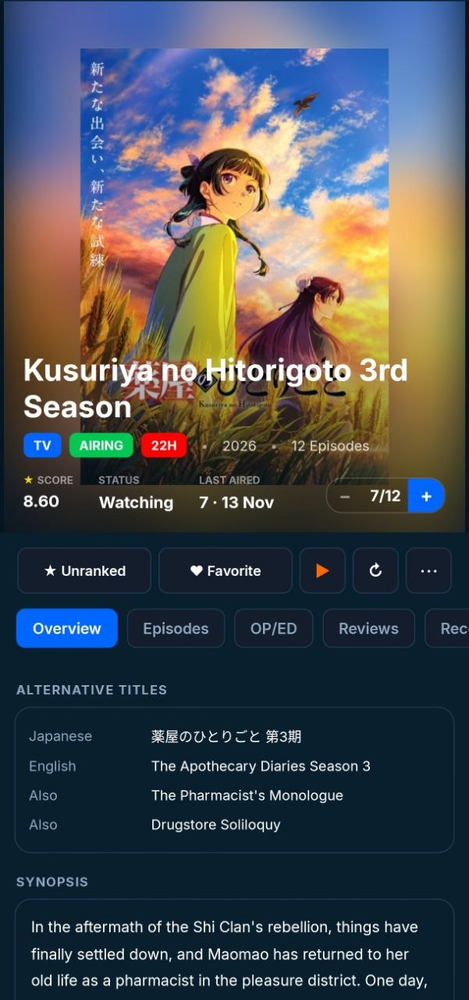
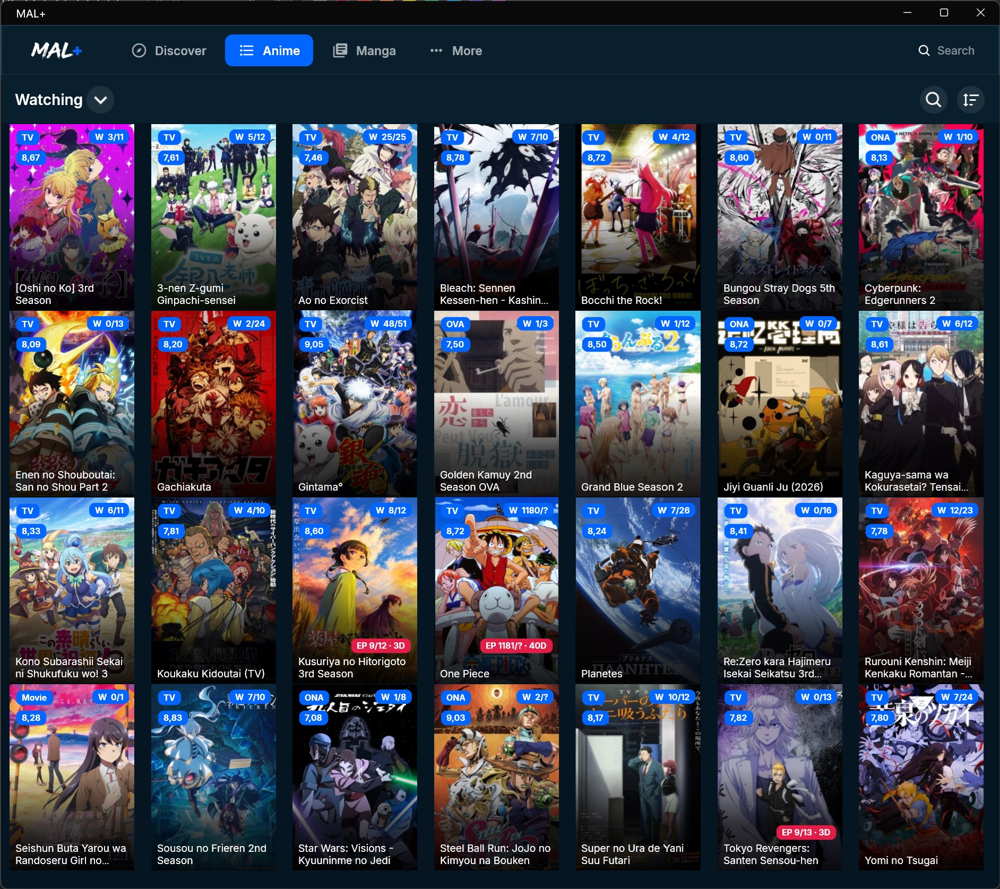
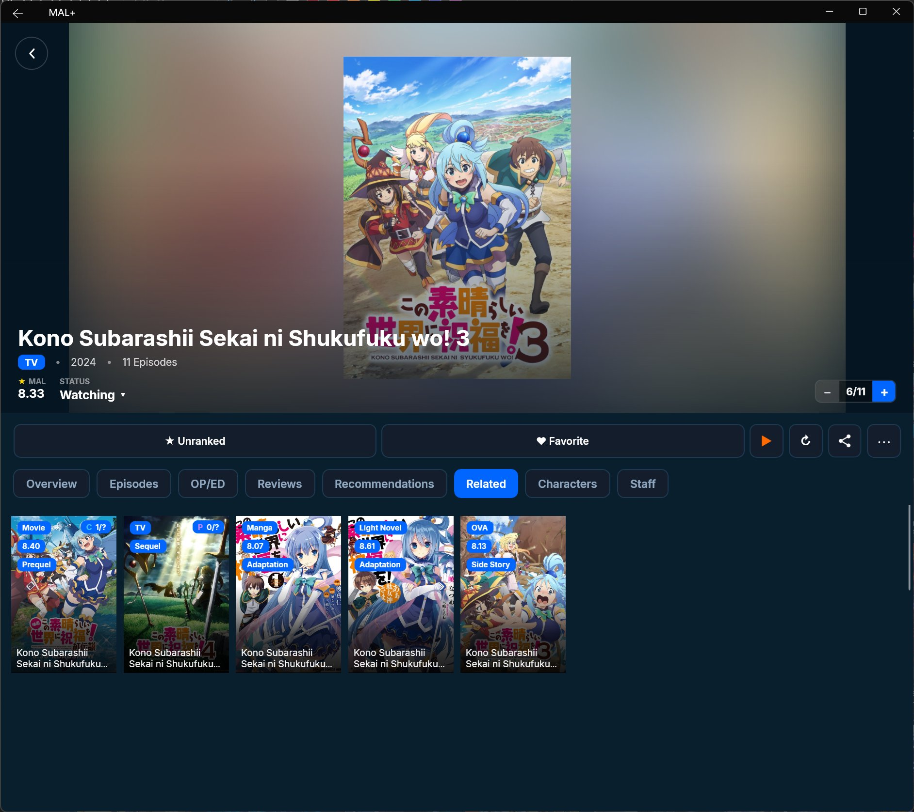
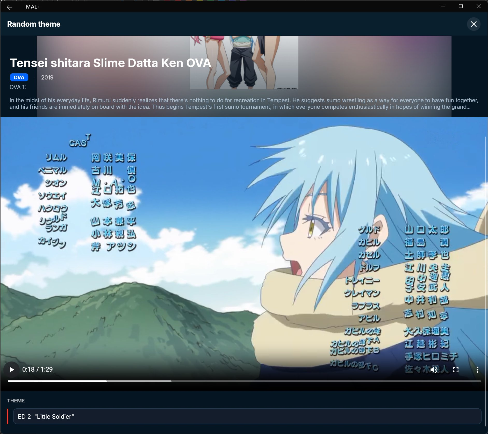

<p align="center">
  
</p>

<h1 align="center">MAL+ (MALPlus) — Enhanced MyAnimeList Client for Android &amp; Windows</h1>

<p align="center">
  <strong>Fast. Pure. Private.</strong><br>
  Track anime and manga with native gestures, stream opening and ending themes, find hidden gems, and keep it all free of ads and telemetry.
</p>

<p align="center">
  <a href="https://github.com/idarkalex/MALPlus/releases/latest"></a>
  &nbsp;
  <a href="https://malplus.vercel.app"></a>
</p>

<p align="center">
  <a href="https://github.com/idarkalex/MALPlus/releases/latest"></a>
  <a href="https://github.com/idarkalex/MALPlus/releases"></a>
  <a href="https://github.com/idarkalex/MALPlus/stargazers"></a>
  <a href="LICENSE.md"></a>
  
  
  
</p>

<p align="center">
  <a href="#why-mal">Why MAL+</a> &bull;
  <a href="#features">Features</a> &bull;
  <a href="#screenshots">Screenshots</a> &bull;
  <a href="#windows-edition-work-in-progress">Windows (WIP)</a> &bull;
  <a href="#install">Install</a> &bull;
  <a href="#build-from-source">Build</a> &bull;
  <a href="#community">Community</a>
</p>

---

## Why MAL+

| | Official MyAnimeList app | **MAL+** |
|---|:---:|:---:|
| **Ads and tracking** | ❌ Ads and analytics | ✅ **Ad-free, zero telemetry** |
| **Navigation** | ⚠️ WebViews, sluggish tab switches | ✅ **Native Android gestures** |
| **Openings and endings** | ❌ None | ✅ **Built-in AnimeThemes player (ExoPlayer)** |
| **Offline resilience** | ❌ Blank screens, failed loads | ✅ **Instant start with resilient offline cache** |
| **Discovery** | ❌ Basic search and rankings | ✅ **Recommendations, OP/ED roulette, filters** |
| **De-Googled devices** | ❌ Needs Google Play Services | ✅ **Standalone: GrapheneOS, LineageOS, microG** |
| **Customization** | ❌ Fixed layout | ✅ **Poster tags, format chips, score modes** |

<sub>Comparison with the official Android app, as of this writing.</sub>

---

## Features

**Track everything**

- **Full library management.** Two-way sync with MyAnimeList: scores, watched episodes, reading volumes, status tags, rewatching progress and private notes.
- **Customizable poster cards.** Format chips (TV, OVA, Movie...), score display modes (community rating, personal score or hidden) and release season tags (Winter 2026, etc.).
- **Broadcast calendar and airing countdowns.** Upcoming episodes with countdowns calculated from release timestamps.
- **Native forums browser.** Read and join MyAnimeList discussions, with quote trees, reply composer and page navigation.

**Listen**

- **Integrated AnimeThemes player.** Native video and audio for openings (OP) and endings (ED) with **AndroidX Media3 (ExoPlayer)**, right inside the anime details.

**Discover** *(experimental / work in progress)*

- **"Because you liked..."** Suggestions based on the titles in your own library.
- **Season openings and endings.** Browse and stream the themes of every current seasonal anime.
- **Random Gem finder.** High-scoring, overlooked classics, with score and genre filters.
- **Music theme roulette.** Random creditless OP/ED videos on demand.
- **Adapted to Anime.** A curated manga filter that shows only series that received an anime adaptation.

**Feel fast, stay private**

- **Fluid dark-first interface.** Native `ViewPager2` tab navigation, swipe gestures between libraries and a bottom bar anchored across the root sections.
- **Built-in updater.** Daily background checks and a one-tap manual check, with the full changelog.
- **100% local.** No third-party telemetry, tracking or analytics. Diagnostics and crash logs can be exported from Settings as a `.txt` bundle through the Android share sheet.

---

## Screenshots

<table align="center">
  <tr>
    <td align="center"><br><sub><b>Library</b></sub></td>
    <td align="center"><br><sub><b>Details and themes</b></sub></td>
    <td align="center"><br><sub><b>Discover</b></sub></td>
  </tr>
</table>

---

## Windows Edition *(Work in Progress)*

MAL+ is expanding to desktop! A dedicated Windows client built with .NET is currently in active development, bringing the full MAL+ experience to widescreen PC monitors:

- **High-Density Desktop Grid:** Browse your entire watching and reading collections with expanded multi-column layouts (up to 8+ posters per row).
- **Integrated AnimeThemes Desktop Player:** Native creditless OP/ED music video playback right on your desktop.
- **Interactive Franchise Trees:** Explore related prequels, sequels, manga adaptations and spin-offs with instant navigation.

<table align="center">
  <tr>
    <td align="center"><br><sub><b>High-Density Library</b></sub></td>
    <td align="center"><br><sub><b>Anime Details &amp; Relations</b></sub></td>
    <td align="center"><br><sub><b>AnimeThemes Player</b></sub></td>
  </tr>
</table>

> ⚠️ **Status:** The Windows desktop version is currently in active development (WIP). Pre-release builds will be published under GitHub Releases.

---

## Install

Download the APK from the **[latest release](https://github.com/idarkalex/MALPlus/releases/latest)**.

1. Download `com.idarkalex.malplus.apk`.
2. Open it on your device. If Android asks, allow *Install unknown apps* for your browser or file manager.
3. Sign in with your MyAnimeList account. Future updates arrive through the built-in updater.

> **De-Googled friendly.** MAL+ needs no Google Play Services or proprietary frameworks. It runs on stock Android and on GrapheneOS, CalyxOS, LineageOS and microG.

---

## Under the hood

<details>
<summary><b>Architecture and tech stack</b></summary>

<br>

| Layer | Technology |
|---|---|
| **Framework** | .NET 11.0 (allow-prerelease) + .NET MAUI workload |
| **Platform target** | Android 7.0 (API 24) to Android 15 (API 35+) |
| **Architecture** | MVVM with decoupled service locators |
| **Media playback** | AndroidX Media3 / ExoPlayer through a custom native MAUI handler |
| **Graphics** | SkiaSharp for Android |
| **Metadata providers** | **Tenrai API** (fast catalogue and episodes fallback), **MyAnimeList API** (user library and auth), **AnimeThemes GraphQL** (openings and endings) |
| **Storage and cache** | Private app storage JSON caches with bounded TTL and stale-while-revalidate degradation |

</details>

---

## Build from source

> **New to Android development?** Follow the step-by-step **[Development and Build Guide](docs/DEVELOPMENT_AND_BUILD.md)** for toolchain setup, device configuration and contribution tips.

**Prerequisites:** Windows 10/11 or Linux with the Android SDK, the [.NET 11 SDK](https://dotnet.microsoft.com/) (preview pinned in `global.json`), the MAUI Android workload (`dotnet workload install maui-android`), JDK 21 and Android SDK build tools 35.0.0+ with platform 33+.

**Dev loop** (incremental build and deploy over adb, WiFi or USB):

```powershell
# Auto-detects the connected device and compiles incrementally
.\build_and_deploy.ps1

# Or target a device explicitly
.\build_and_deploy.ps1 -Device "192.168.1.XXX:PORT"
```

> Builds must stay incremental. Avoid `dotnet build -t:Rebuild`, which discards the build caches.

**Release build:**

```bash
dotnet build MALPlus/MALPlus.csproj -f net11.0-android37.0 -p:Configuration=Release
```

---

## Community

- **Found a bug?** Open a **[bug report](https://github.com/idarkalex/MALPlus/issues/new?template=bug_report.yml)** with your device model, Android version and the diagnostic log exported from *Settings > Diagnostics and logs*.
- **Have an idea?** Send a **[feature request](https://github.com/idarkalex/MALPlus/issues/new?template=feature_request.yml)**.
- **Want to contribute?** Read the **[contributing guidelines](CONTRIBUTING.md)** before opening a pull request.

---

## Credits

MAL+ exists thanks to the open-source community:

- **[Drutol](https://github.com/Drutol)**: author of the original [MALClient](https://github.com/Drutol/MALClient) (UWP / Xamarin), the foundation of this client.
- **[idarkalex](https://github.com/idarkalex)**: maintainer, responsible for the fork, the .NET 11 MAUI rewrite and the performance work.
- **[Tenrai API](https://api.tenrai.org)**: fast, reliable anime and manga metadata and episode catalogue.
- **[AnimeThemes](https://animethemes.moe)**: an open repository of high-definition anime themes (OP/ED).
- **[MyAnimeList](https://myanimelist.net)** and **[AniList](https://anilist.co)**: the communities and databases that make this app possible.

---

## License

MAL+ is open-source software under the **[GNU General Public License v3 (GPLv3)](LICENSE.md)**.

<sub>MyAnimeList is a registered trademark of MyAnimeList, LLC. MAL+ is an independent open-source client and is not affiliated with or endorsed by MyAnimeList.</sub>
