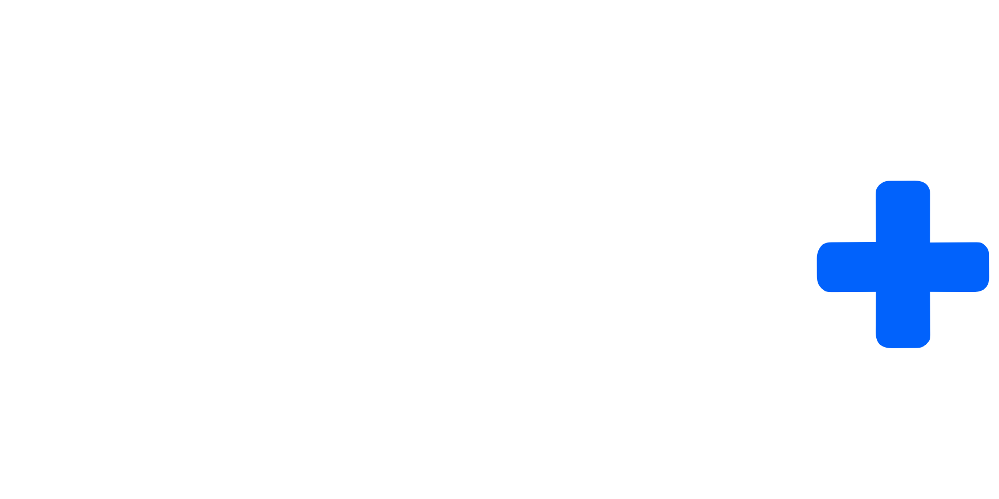
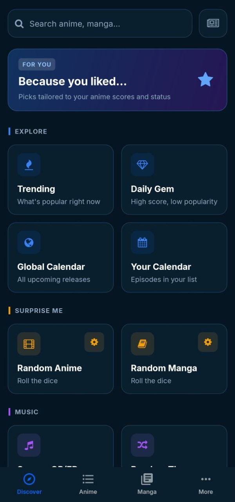

<p align="center">
  
</p>

<h1 align="center">MAL+ — Enhanced MyAnimeList Client</h1>

<p align="center">
  <strong>The fast, modern, and privacy-focused MyAnimeList client for Android.</strong><br>
  Manage your anime and manga libraries with native gestures, stream integrated anime themes, discover hidden gems, and enjoy a clean experience with zero ads or telemetry.
</p>

<p align="center">
  <a href="https://malplus.vercel.app"></a>
  <a href="https://github.com/idarkalex/MALPlus/releases/latest"></a>
  <a href="https://github.com/idarkalex/MALPlus/releases"></a>
  <a href="https://github.com/idarkalex/MALPlus/stargazers"></a>
  
  
  
  
</p>

<p align="center">
  <a href="https://malplus.vercel.app">
    
  </a>
  &nbsp;
  <a href="https://github.com/idarkalex/MALPlus/releases/latest">
    
  </a>
</p>

<p align="center">
  <a href="https://malplus.vercel.app">🌐 Official Website</a> &bull;
  <a href="#-why-mal">Why MAL+?</a> &bull;
  <a href="#-features">Features</a> &bull;
  <a href="#-preview--screenshots">Screenshots</a> &bull;
  <a href="#-download--installation">Download</a> &bull;
  <a href="#️-building-from-source">Build from Source</a>
</p>

---

## 💡 Why MAL+?

| Feature | Official MyAnimeList App | **MAL+** |
|---|:---:|:---:|
| **Ads & Tracking** | ❌ Contains ads and analytics | ✅ **100% Ad-free, zero telemetry** |
| **Interface & Navigation** | ⚠️ WebViews & sluggish tab switches | ✅ **Native Android gestures & fluid navigation** |
| **Openings & Endings** | ❌ None | ✅ **Built-in AnimeThemes player (ExoPlayer)** |
| **Offline Resilience** | ❌ Blank screens / failed loads | ✅ **Instant startup with resilient offline caching** |
| **Discovery Tools** | ❌ Basic search & ranking lists | ✅ **Recommendation engine, OP/ED roulette & filters** |
| **De-Googled Devices** | ❌ Requires Google Play Services | ✅ **100% standalone (works on GrapheneOS / LineageOS / microG)** |
| **Customization** | ❌ Fixed layout | ✅ **Custom poster tags, format chips & score modes** |

---

## ✨ Features

- 🎨 **Fluid Dark-First Interface:** Built specifically for Android with native `ViewPager2` tab navigation, smooth swipe gestures between libraries, and an interactive bottom bar that stays anchored across root sections.
- 🧭 **Exclusive Discovery Hub *(Experimental / WIP)*:** Explore unique discovery tools found only in MAL+:
  - **"Because You Liked..." Recommendations:** Tailored algorithmic suggestions based on titles in your personal library.
  - **Season Openings & Endings (OP/ED):** Browse and stream theme songs for all current seasonal anime via AnimeThemes.
  - **Random Gem Finder:** Unearth high-scoring hidden gems and overlooked classics with configurable score and genre filters.
  - **Music Theme Roulette:** Play random creditless OP/ED music videos on demand.
  - **Adapted to Anime:** Unique curated manga filter showing exclusively manga series that have received an anime adaptation.
- 🎵 **Integrated AnimeThemes Player:** Native video and audio playback for Opening (OP) and Ending (ED) themes powered by **AndroidX Media3 (ExoPlayer)** directly within anime details.
- 📚 **Full Library Management:** Seamless two-way sync with MyAnimeList. Update scores, watched episodes, reading volumes, status tags, rewatching progress, and private notes.
- 🏷️ **Customizable Poster Cards:** Personalize your list view with format chips (TV, OVA, Movie...), score display modes (community rating, personal score, or hidden), and release season tags (Winter 2026, etc.).
- 📅 **Broadcast Calendar & Airing Countdowns:** Keep track of upcoming episodes with accurate broadcast countdowns calculated dynamically from release timestamps.
- 💬 **Native Forums Browser:** Read and participate in MyAnimeList community discussions natively—featuring quote trees, reply composers, and page navigation.
- 🔄 **Integrated In-App Updater:** Daily background update checks and one-tap manual checks that notify you when a new release is available with full changelog view.
- 🛡️ **100% Local & Private:** Zero third-party telemetry, zero tracking, and no external analytics. Local diagnostics and crash logs can be exported directly from Settings to a `.txt` support bundle via the Android share sheet.

---

## 📱 Preview & Screenshots

<p align="center">
  
  &nbsp;&nbsp;&nbsp;&nbsp;
  
  &nbsp;&nbsp;&nbsp;&nbsp;
  
</p>

---

## 📥 Download & Installation

You can download the latest installable APK directly from the **[Releases](https://github.com/idarkalex/MALPlus/releases)** page.

1. Download `com.idarkalex.malplus.apk` from the latest release.
2. Open the downloaded file on your Android device (ensure *"Install unknown apps"* permission is granted for your browser or file manager).
3. Sign in with your MyAnimeList account to sync your library and access all features.

> **Privacy & De-Googled Friendly:** MAL+ requires **no Google Play Services** or proprietary frameworks. It runs seamlessly on stock Android as well as privacy-oriented OS distributions such as GrapheneOS, CalyxOS, LineageOS, or microG environments.

---

## 🏗️ Architecture & Tech Stack

| Layer | Technology |
|---|---|
| **Framework** | .NET 11.0 (allow-prerelease) + .NET MAUI Workload |
| **Platform Target** | Android 7.0 (API 24) to Android 15 (API 35+) |
| **Architecture** | MVVM (Model-View-ViewModel) with decoupled service locators |
| **Media Playback** | AndroidX Media3 / ExoPlayer via custom native MAUI handler |
| **Graphics & Drawing** | SkiaSharp for Android |
| **Metadata Providers** | **Tenrai API** (high-speed catalogue & episodes fallback), **MyAnimeList API** (user library & auth), and **AnimeThemes GraphQL** (openings & endings) |
| **Storage & Cache** | Private app storage JSON caches with bounded TTL and stale-while-revalidate degradation |

---

## 🛠️ Building from Source

> 💡 **New to Android or mobile development?** Check out our dedicated, step-by-step **[Development & Build Guide (DEVELOPMENT_AND_BUILD.md)](docs/DEVELOPMENT_AND_BUILD.md)** for a complete walkthrough on toolchain installation, device setup, and beginner-friendly contribution tips!

### Prerequisites
- Windows 10/11 or Linux with Android SDK installed
- [.NET 11 SDK](https://dotnet.microsoft.com/) (preview version pinned in `global.json`)
- .NET MAUI Android workload (`dotnet workload install maui-android`)
- JDK 21 (Microsoft OpenJDK recommended)
- Android SDK build tools 35.0.0+ and platform 33+

### Incremental Build & Deploy (Dev Loop)

For active local iteration over adb (WiFi or USB):

```powershell
# Auto-detects connected device and incremental compile
.\build_and_deploy.ps1

# Or specify a target device explicitly:
.\build_and_deploy.ps1 -Device "192.168.1.XXX:PORT"
```

> **Note:** Compilations must always be incremental. Avoid running `dotnet build -t:Rebuild`, as it discards build caches.

### Release Build

```bash
dotnet build MALPlus/MALPlus.csproj -f net11.0-android37.0 -p:Configuration=Release
```

---

## 🤝 Community & Support

- **Found a bug?** Open a **[Bug Report](https://github.com/idarkalex/MALPlus/issues/new?template=bug_report.yml)**. Please include your device model, Android OS version, and export your local diagnostic log from *Settings > DIAGNOSTICS & LOGS*.
- **Have an idea?** Submit a **[Feature Request](https://github.com/idarkalex/MALPlus/issues/new?template=feature_request.yml)** to suggest new features or visual enhancements.
- **Want to contribute?** Read our **[Contributing Guidelines](CONTRIBUTING.md)** before opening a Pull Request.

---

## 💖 Acknowledgments & Credits

MAL+ is built with immense gratitude towards the open-source community:

- **[Drutol](https://github.com/Drutol)**: Author and creator of the original [MALClient](https://github.com/Drutol/MALClient) (UWP / Xamarin), which laid the foundation for this client.
- **[idarkalex](https://github.com/idarkalex)**: Project maintainer, responsible for the fork, modern .NET 11 MAUI rewrite, and performance enhancements.
- **[Tenrai API](https://api.tenrai.org)**: For providing fast, reliable anime and manga metadata and episode catalogue APIs.
- **[AnimeThemes](https://animethemes.moe)**: For maintaining an open repository of high-definition anime themes (OP/ED).
- **[MyAnimeList](https://myanimelist.net)** & **[AniList](https://anilist.co)**: For providing the core anime communities and databases that make this app possible.

---

## 📄 License

MAL+ is open-source software licensed under the **[GNU General Public License v3 (GPLv3)](LICENSE.md)**.
